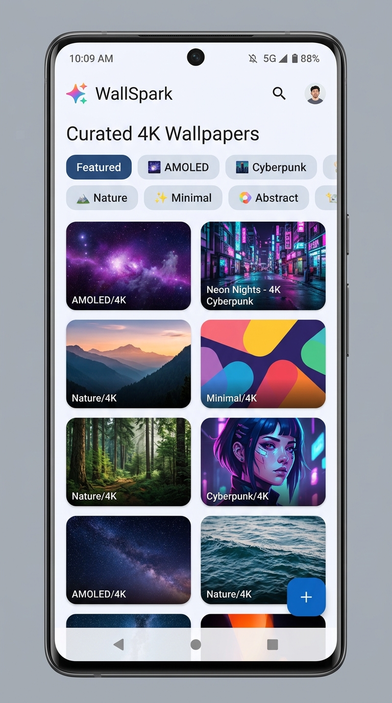
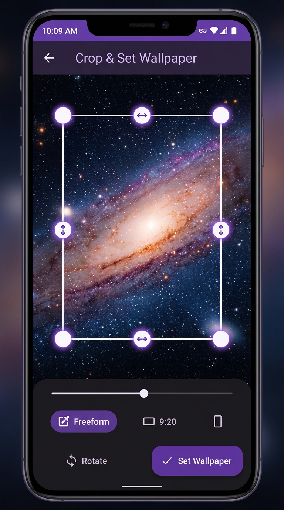
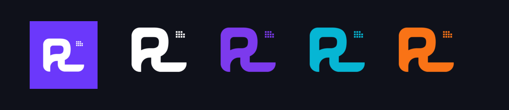

<p align="center">
  
</p>

<h1 align="center">PixelLoom</h1>

<p align="center">
  <strong>Curated High-Resolution Wallpapers Across the Web</strong><br>
  Built with Kotlin & Jetpack Compose • Material 3 • Freeform Cropping • 24+ Sources
</p>

<p align="center">
  <a href="#-direct-apk-download--installation"></a>
  
  
  
  
</p>

---

## 📱 About PixelLoom

**PixelLoom** weaves together premier creative communities and digital art archives into a unified, high-performance Android wallpaper hub. Engineered for complete reliability across all physical Android devices (Android 7.0 / API 24 through Android 15 / API 36), PixelLoom features a signature **Purple & White** brand identity, adaptive launcher icon, interactive **Freeform Cropping & Positioning**, and custom resolution downloads.

---

## 📥 Direct APK Download & Installation

The signed debug APK is ready for immediate installation on any physical Android device or emulator:

| Artifact | Direct Link | File Size | Compatibility |
|---|---|---|---|
| 🚀 **PixelLoom v1.0 Universal APK** | **[Download PixelLoom-v1.0-debug.apk](./PixelLoom-v1.0-debug.apk)** | ~18 MB | Android 7.0+ (API 24 - 36) |
| 📦 **Gradle Build Output** | `app/build/outputs/apk/debug/app-debug.apk` | ~18 MB | Universal |

### Quick Installation Guide
1. **Download:** Click the direct link above to download **[`PixelLoom-v1.0-debug.apk`](./PixelLoom-v1.0-debug.apk)** directly to your Android device.
2. **Install:** Tap the downloaded file in your browser or File Manager.
3. **Allow Source:** When prompted, toggle "Allow from this source" in system settings.
4. **Launch:** Open **PixelLoom** from your app drawer and enjoy ultra-fast, crash-free browsing!

---

## 📸 App Screenshots

<p align="center">
  
  &nbsp;&nbsp;&nbsp;&nbsp;
  
</p>

---

## 🎨 Brand Identity & Logo Colorways

PixelLoom features a distinctive woven pixel icon motif. The app icon pairs a royal purple backdrop (`#6B38FB`) with a crisp white cutout logo in front, complemented by dynamic multi-color variants across the UI:

<p align="center">
  
</p>

- **Launcher Icon:** Royal Purple background (`#6B38FB`) with pure white logo cutout (`#FFFFFF`) in front, fully adaptive across Android 8.0+ squircle/round masking.
- **Splash Screen:** Beautiful dual light and dark mode splash screen with pulsing ambient aura, squircle badge, and animated typography.
- **Multi-Color Spectrum:** Dynamic color accents including **Royal Purple**, **Cyber Cyan**, **Sunset Amber**, and **Emerald Mint**.

---

## 🛡️ Robust Startup Architecture (Crash-Proof)

The latest build addresses all physical device startup edge-cases:
- **Clean Manifest & Zero Firebase Dependencies:** Removed unused Google Services providers that previously caused `IllegalStateException` crashes on launch when running without backend credentials.
- **Resilient WorkManager & Notification Channels:** Notification channels and background workers are isolated with defensive exception handling and standard monochromatic notification drawables (`ic_notification`).
- **Thread-Safe Lazy Initialization:** Application singletons (Database, Repository, ActionManager) use thread-safe Kotlin lazy delegates to eliminate race conditions during cold starts and activity recreation.
- **Scoped Storage & WallpaperManager Guarding:** Media storage and lock-screen wallpaper operations are guarded with OEM-specific API level checks.

---

## ✨ Key Features

### 🌐 24+ Curated Wallpaper Sources
- **Reddit Feeds:** `r/Amoledbackgrounds`, `r/wallpaper`, `r/Verticalwallpapers`, `r/MobileWallpaper`, `r/MinimalWallpaper`
- **Photography:** Unsplash, Pexels, Pixabay, StockSnap.io, Freepik
- **Design & Digital Art:** Wallhaven, Wallpaper Alpha Coders, Anime Wallpaper, Simple Desktops, Designspiration, Pinterest, DeviantArt, Zedge, Wallpaper Cave, WallpaperSafari, Wallpapers.com, WallpapersWide, InterfaceLIFT, Mobiles Wall

### ✂️ Interactive Freeform Crop & Quick Set
- **Single-Tap Workflow:** Direct "Set Wallpaper" action with interactive preview.
- **Freeform Resizing:** Drag corner handles to crop any rectangular area with rule-of-thirds grid overlay.
- **Aspect Ratio Presets:** Switch between **Freeform**, **Phone (9:20)**, **Portrait (9:16)**, **Square (1:1)**, and **Wide (16:9)**.
- **Full Image Mode:** One-tap option to apply wallpapers in their native aspect ratio without cropping.

### 📐 Custom Resolutions & Downloads
- High-res downloads saved directly to `Pictures/PixelLoom`.
- Presets for FHD+, QHD+, 4K UHD, Super Retina, and custom pixel dimensions.

### 💾 Local Room Database
- **Favorites:** Offline bookmarks with instant toggle.
- **Download History:** Log of saved wallpapers, dimensions, and local URIs.

---

## 🛠️ Tech Stack

- **Language:** Kotlin 2.2
- **UI Toolkit:** Jetpack Compose with Material 3 (Dual Light & Dark Theme)
- **Image Loading:** Coil 2.7
- **Database:** Android Room 2.7 with KSP
- **Background Tasks:** AndroidX WorkManager
- **Networking:** OkHttp 4.12, Retrofit 2.11, Jsoup
- **Testing:** Robolectric & JUnit 4 JVM testing

---

## 🚀 Building From Source

```bash
# Clone the repository
git clone https://github.com/your-username/PixelLoom.git
cd PixelLoom

# Build debug APK
gradle assembleDebug

# Run unit & Robolectric tests
gradle :app:testDebugUnitTest
```

---

## 📄 License

Licensed under the [MIT License](LICENSE).
